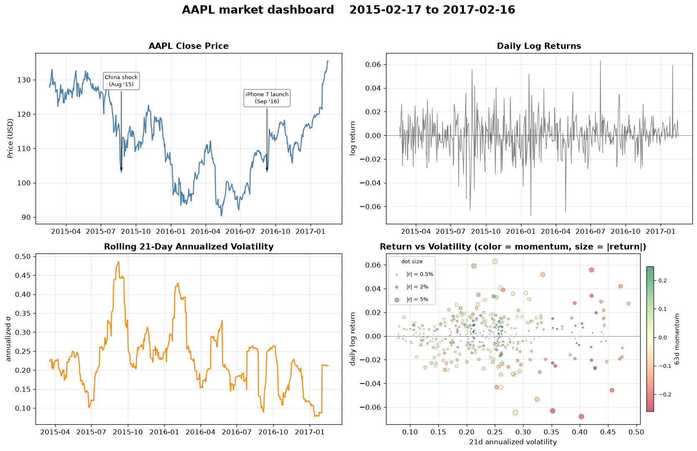

# Market Dashboard

Offline briefing for a single stock. It answers one question from a price history you already have: **is the latest volatility quiet or elevated for this stock, and is the trailing trend up or down?**

The default run uses Apple daily prices bundled in this repo (17 Feb 2015 – 16 Feb 2017). No API key, no brokerage login, and no network call.



## Setup

Python 3.12. From the repository root:

```bash
python3 -m venv .venv
source .venv/bin/activate
pip install -r requirements.txt
```

The pinned stack is `numpy==2.5.5`, `pandas==3.1.1`, `matplotlib==3.11.2`, and `streamlit==1.67.0`. Streamlit is only required for the browser demo. The command-line briefing imports numpy, pandas, and matplotlib.

## Worked example

The workflow is a pre-meeting risk briefing for one ticker.

1. Load an OHLCV file. The default is `aapl_raw.csv`.
2. Build causal features: daily log return, rolling annualized volatility, trailing momentum.
3. Read the **latest** warmed-up day as the regime, and keep the whole path on the chart so an earlier shock is still visible.
4. Write a one-paragraph briefing and a four-panel figure.

### Command line

```bash
python dashboard.py
```

```text
AAPL as of 2017-02-16: close 135.35 (session log return -0.12%). 21-day annualized volatility is 21.2%, typical for this file (44th percentile, median 22.4%). 63-day momentum is an uptrend: +26.4% over the window. Peak 21-day vol in this file was 48.6% on 2015-09-08.
File covers 2015-02-17 to 2017-02-16. 443 days have both features fully warmed up.
Saved dashboard to dashboard.png
```

How to read that: at the end of the sample, AAPL is back near its highs and the last quarter is an uptrend, while 21-day volatility is ordinary for this file (middle of its own history). The chart still shows the stress episode. The 48.6% peak prints on 8 Sep 2015, not on the 24 Aug China-shock day, because a 21-day window reaches its high once those crash days have filled the window.

The same briefing with slower windows (one quarter of volatility, about six months of momentum) flips the vol label from typical to quiet:

```bash
python dashboard.py --vol-window 63 --mom-window 126 --output dashboard_slow.png
```

```text
AAPL as of 2017-02-16: close 135.35 (session log return -0.12%). 63-day annualized volatility is 15.6%, quiet for this file (4th percentile, median 24.2%). 126-day momentum is an uptrend: +23.9% over the window. Peak 63-day vol in this file was 34.9% on 2015-10-29.
File covers 2015-02-17 to 2017-02-16. 380 days have both features fully warmed up.
Saved dashboard to dashboard_slow.png
```

The sample file is found next to the code, so this works from any working directory:

```bash
python /path/to/market-dashboard/dashboard.py --output ./briefing.png
```

Optional flags:

| Flag | Default | Role |
|---|---|---|
| `--csv` | bundled `aapl_raw.csv` | Another OHLCV file. See the column layout below. |
| `--ticker` | inferred from names like `AAPL.Close` | Label in the title and the sentence. |
| `--vol-window` | 21 | Trading days in the volatility window. |
| `--mom-window` | 63 | Trading days in the momentum window. |
| `--output` | `dashboard.png` | Where the figure is written. |

### Browser

From the repository root:

```bash
streamlit run app.py
```

Leave the file picker empty. The page briefs the bundled sample. Move the two window sliders to change the regime read; stretching volatility from 21 to 63 days is the comparison above. **Download PNG** saves the figure.

To brief a different history, upload a CSV. That file is read locally. The app does not call a data vendor. Accepted headers:

- `Date, Open, High, Low, Close, Volume` (any capitalization), or
- ticker-prefixed names, as in the sample: `Date, AAPL.Open, AAPL.High, AAPL.Low, AAPL.Close, AAPL.Volume`

Extra columns (adjusted close, vendor moving averages) are ignored. Pass `--ticker DEMO` or type a label in the sidebar when the file has generic column names; otherwise the prefix is the ticker, and generic files are labeled `UNKNOWN`.

## Tests

```bash
python -m unittest discover -s tests -v
```

The tests cover the sample contract, column layouts, bad files, the annualization math, the AAPL briefing numbers, and the guarantee that event callouts are not drawn on a file that does not cover those dates.

## What the four panels show

| Panel | Question |
|---|---|
| **Price** | Where has the close been? The bundled sample annotates 24 Aug 2015 and 9 Sep 2016. |
| **Daily log returns** | What does the day-to-day move look like? |
| **Rolling annualized volatility** | How has the risk regime changed? |
| **Return vs volatility** | Are large days happening in an uptrend or a downtrend? Color is momentum, size is the absolute return. |

Regime words used in the sentence:

- **Volatility** is quiet below the 20th percentile of this file, elevated at or above the 80th, and typical in between. Ties use a mid-rank, so a flat series stays typical.
- **Momentum** is an uptrend above +0.05 cumulative log return over the window, a downtrend below −0.05, and flat inside that band. The sentence also prints the simple percent change, `exp(log return) − 1`.

## Architecture

One direction. One file per job. `plots.py` does not read a CSV. `features.py` does not import matplotlib. `dashboard.py` is the only end-to-end path. `app.py` only collects inputs and displays that result.

```
data_loader.py  →  features.py  →  plots.py  →  dashboard.py  →  app.py
   (clean OHLCV)    (signals)       (figure)     (briefing)      (browser)
```

## Quant choices

- **Log returns** add across time and treat up and down moves symmetrically.
- **Annualization uses √252**, the trading-day count, not √365.
- **Rolling windows are causal.** Each point uses the past only, so the scatter is a view you could have had on that day.
- **Volatility is ranked inside the loaded file.** "Elevated" means elevated for this history, not "above 20%" and not "above the VIX".

## Data

`aapl_raw.csv` is the public Apple series from the [plotly/datasets](https://github.com/plotly/datasets) collection, stored in the repo so the demo runs offline. The briefing uses the unadjusted close. This date range contains no split.

## Known limitations

- The bundled history ends on 16 Feb 2017. The briefing is about that sample, not today's market.
- One ticker at a time. There is no portfolio, benchmark, or options view.
- Event callouts are the two dates above. They are drawn only when the file covers them (within 7 calendar days).
- The first 21 volatility points and the first 63 momentum points are blank on purpose. That warmup is the rolling window filling up.
- A window longer than the file fails with a clear error instead of inventing a regime.
- Closes are unadjusted. A file that spans a split will mix the pre-split and post-split price levels.
- The vol label compares the stock with itself, inside the file you loaded.
- The demo never places an order and never contacts a market-data API. A different history is an optional CSV you supply.

## Publish on Streamlit Community Cloud

This is the free host that matches the stack. No secret is required.

1. Merge this project to `main` (or deploy the branch directly if you only want a preview).
2. Open [share.streamlit.io](https://share.streamlit.io) and sign in with GitHub.
3. Choose **Create app**, then **Yup, I have an app**.
4. Set the repository, branch `main`, and main file path `app.py`.
5. Open **Advanced settings** and select **Python 3.12**. Leave secrets empty.
6. Deploy. Community Cloud installs `requirements.txt` and starts `streamlit run app.py` from the repo root.

The public URL looks like `https://<name>.streamlit.app`.
