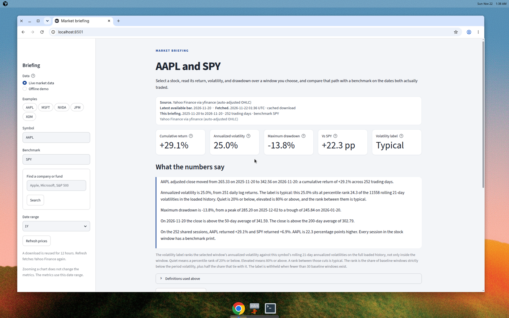
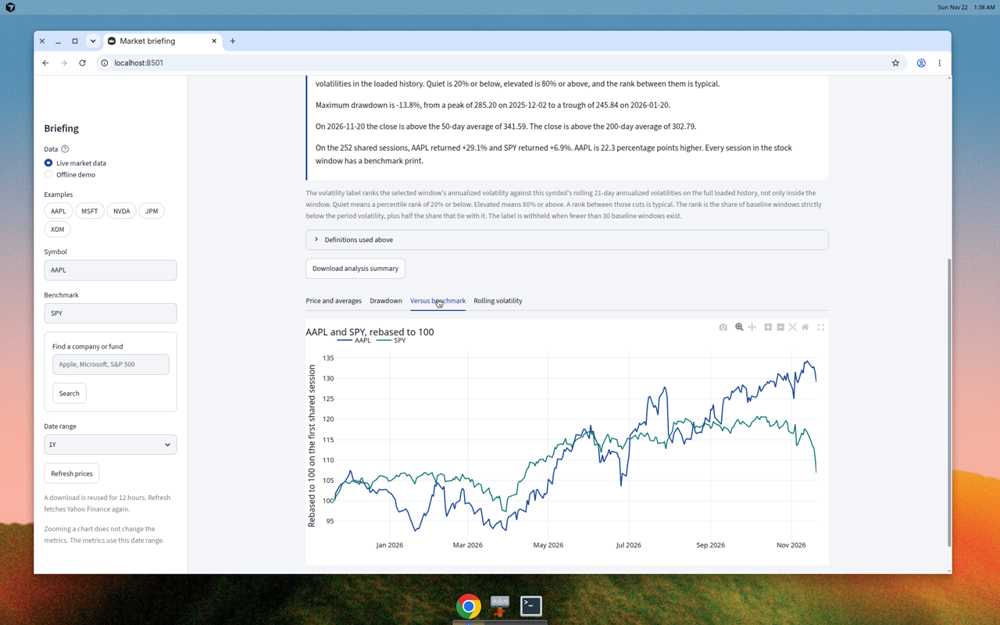
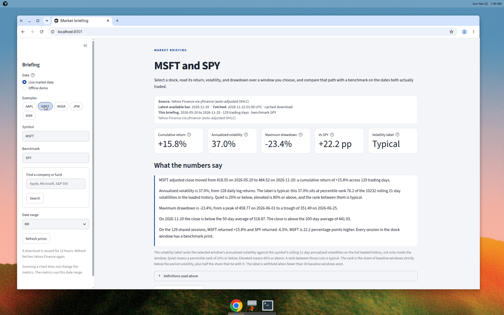
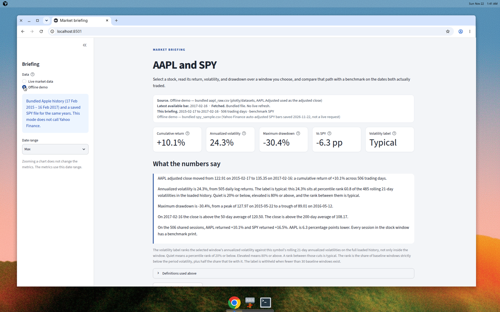

# Market briefing

A single-stock briefing you can show to a client. Pick a symbol, choose a window, and read the return, the risk, and the comparison with a benchmark. Every sentence on the page is filled from those calculations.

Live prices come from Yahoo Finance through [yfinance](https://github.com/ranaroussi/yfinance). No API key. The bundled Apple file remains available as an explicit offline demo, with a saved SPY history for the same years.



The numbers in the screenshots and the worked example below were produced on 22 Nov 2026, when the latest Yahoo bar was 20 Nov 2026. A later run prints new prices. The definitions do not change.

## Setup

Python 3.12. From the repository root:

```bash
python3 -m venv .venv
source .venv/bin/activate
pip install -r requirements.txt
```

Pinned packages: `numpy==2.5.5`, `pandas==3.1.1`, `streamlit==1.67.0`, `yfinance==0.2.66`, `plotly==6.3.1`.

## Worked example

### Live, in the browser

```bash
streamlit run app.py
```

Leave **Live market data** selected. The page loads AAPL against SPY for the last year.

On 22 Nov 2026 that window was 252 trading days, 20 Nov 2025 through 20 Nov 2026:

- Cumulative return **+29.1%** (adjusted close 265.33 to 342.56)
- Annualized volatility **25.0%**, labeled **typical** because that figure sits at percentile rank 24.3 of AAPL's own rolling 21-day volatilities (quiet is 20 or below, elevated is 80 or above)
- Maximum drawdown **−13.8%**, from 285.20 on 2 Dec 2025 to 245.84 on 20 Jan 2026
- Versus SPY **+22.3 percentage points** (SPY returned +6.9% on the same 252 sessions)

The status line names the source (Yahoo Finance, auto-adjusted OHLC), the latest bar in the download, and the time that download was fetched. A cached file is reused for 12 hours. **Refresh prices** downloads again.

Change the window to 6M and the same symbol prints a different result: **+13.5%** over 129 sessions, volatility 27.4%, drawdown −12.7%. Switching the symbol to MSFT, still on 6M, prints **+15.8%**, volatility 37.0% (percentile rank 76.2, still typical), drawdown −23.4% from 1 Jun 2026 to 25 Jun 2026, and SPY at −6.5% over those shared sessions.





An unknown symbol stops with a message and does not invent a chart:


**Download analysis summary** saves the same sentences and the definitions as Markdown.

The command-line form of the one-year AAPL briefing:

```bash
python dashboard.py --ticker AAPL --benchmark SPY --preset 1Y
```

```text
AAPL adjusted close moved from 265.33 on 2025-11-20 to 342.56 on 2026-11-20: a cumulative return of +29.1% across 252 trading days.
Annualized volatility is 25.0%, from 251 daily log returns. The label is typical: this 25.0% sits at percentile rank 24.3 of the 11558 rolling 21-day volatilities in the loaded history. Quiet is 20% or below, elevated is 80% or above, and the rank between them is typical.
Maximum drawdown is -13.8%, from a peak of 285.20 on 2025-12-02 to a trough of 245.84 on 2026-01-20.
On 2026-11-20 the close is above the 50-day average of 341.59. The close is above the 200-day average of 302.79.
On the 252 shared sessions, AAPL returned +29.1% and SPY returned +6.9%. AAPL is 22.3 percentage points higher. Every session in the stock window has a benchmark print.
Saved summary to analysis.md
```

Other presets: `1M`, `3M`, `6M`, `YTD`, `1Y`, `3Y`, `5Y`, `Max`. Or pass both `--start` and `--end` as `YYYY-MM-DD`.

### Offline demo

In the sidebar choose **Offline demo**. Nothing is downloaded. The stock is `aapl_raw.csv` (plotly/datasets, using the `AAPL.Adjusted` column). The benchmark is `spy_sample.csv`, a Yahoo Finance auto-adjusted SPY history for Feb 2015–Feb 2017 saved in this repo on 22 Nov 2026.

```bash
python dashboard.py --offline --preset Max
```

```text
AAPL adjusted close moved from 122.91 on 2015-02-17 to 135.35 on 2017-02-16: a cumulative return of +10.1% across 506 trading days.
Annualized volatility is 24.3%, from 505 daily log returns. The label is typical: this 24.3% sits at percentile rank 60.8 of the 485 rolling 21-day volatilities in the loaded history.
Maximum drawdown is -30.4%, from a peak of 127.97 on 2015-05-22 to a trough of 89.01 on 2016-05-12.
On 2017-02-16 the close is above the 50-day average of 120.50. The close is above the 200-day average of 108.17.
On the 506 shared sessions, AAPL returned +10.1% and SPY returned +16.5%. AAPL is 6.3 percentage points lower. Every session in the stock window has a benchmark print.
```



The offline demo only contains AAPL and SPY. Other symbols ask you to switch back to live data. A one-day window reports that a return needs two adjusted closes.

## How the figures are defined

- **Cumulative return** is the adjusted close on the last session of the window divided by the adjusted close on the first session, minus one.
- **Annualized volatility** is the sample standard deviation (divisor N−1) of daily log returns inside the window, multiplied by the square root of 252. Log return is the natural log of today's adjusted close over yesterday's. At least two daily returns are required.
- **Maximum drawdown** is the deepest decline from a prior peak to a later close inside the window. The peak is the highest adjusted close on or before the trough. A window that never closes below a prior peak has a drawdown of zero.
- **Moving averages** are simple averages of adjusted close, 50 days and 200 days. They are computed on the full loaded history and then drawn on the selected dates, so a 200-day average can appear inside a shorter window when earlier bars were loaded.
- **Volatility label.** The window's annualized volatility is ranked against this symbol's rolling 21-day annualized volatilities on the **full loaded history**, not only inside the window. Quiet means a percentile rank of 20% or below. Elevated means 80% or above. A rank between those cuts is typical. The rank is the share of baseline windows strictly below the period volatility, plus half the share that tie. The label is withheld when fewer than 30 baseline windows exist. The page prints the rank next to the word, so the cut is visible.
- **Benchmark gap.** Dates are an inner join: a session missing on either side is left out, not filled. Both series are adjusted closes. Each cumulative return runs from the first shared session to the last. The gap is the stock's cumulative return minus the benchmark's, in percentage points. It is not a regression alpha.

Zooming a chart does not change the metrics. The metrics use the sidebar dates.

Live OHLC from Yahoo is fetched with `auto_adjust=True`, so the stock and the benchmark are adjusted the same way. The analysis itself always reads the `adj_close` column.

## Tests

```bash
python -m unittest discover -s tests -v
```

`tests/test_calculations.py` checks hand-computed returns, the annualized-volatility formula, a known peak-to-trough drawdown (−25% from 120 to 90), moving-average warmup, date alignment without filling gaps, and that a jumpy window is labeled elevated against a calm history. `tests/test_pipeline.py` checks the bundled files, the offline briefing, a too-short window, the disk cache, and a live Yahoo fetch for AAPL, SPY, a Microsoft search, and an unknown symbol.

## Layout

```
data_loader.py   prices, search, 12-hour cache, bundled files
features.py      returns, risk, averages, sentences
plots.py         Plotly charts
dashboard.py     one briefing, command line, Markdown summary
app.py           the page
```

`plots.py` does not read files. `features.py` does not draw. `dashboard.py` is the only place the pieces are assembled. `app.py` only collects inputs and displays that result.

## Known limitations

- The live path needs Yahoo Finance to answer. There is no key, and there is also no contract: if Yahoo changes or rate-limits the request, the page shows the error and the offline demo is still in the sidebar.
- yfinance 0.2.66 prints pandas deprecation warnings under pandas 3.1. The downloads used here still return adjusted history.
- The volatility label is a rank inside one symbol's own history. A 25% year can be "typical" when older decades were wilder. Read the percentile next to the word. It is not a comparison with the VIX.
- Offline AAPL is the 2017-vintage plotly file. Offline SPY was saved from Yahoo on 22 Nov 2026. Each comparison uses that file's own adjusted close and the chart rebases both to 100, so dollar levels are not overlaid. The two files were not adjusted on the same day.
- The offline sample ends 16 Feb 2017.
- One stock and one benchmark. No portfolio, no trades, no options.
- The cache is a local `.cache/` directory, ignored by git, and it expires after 12 hours.
- Symbol search returns equities and ETFs. A blank or a symbol with spaces or punctuation is rejected before any download.

## Publish on Streamlit Community Cloud

No secret is required. The deployed app does need outbound HTTPS to Yahoo Finance for live symbols. The offline demo does not.

1. Open [share.streamlit.io](https://share.streamlit.io) and sign in with the GitHub account that owns `mastermind7610/market_dashboard`.
2. Choose **Create app**, then **Yup, I have an app**.
3. Repository `mastermind7610/market_dashboard`, branch `main` after this pull request is merged (or branch `cursor/risk-regime-demo-5ee9` to preview the draft), main file path `app.py`.
4. Under **Advanced settings**, select **Python 3.12**. Leave secrets empty.
5. Deploy. Community Cloud installs `requirements.txt` and runs `streamlit run app.py`.

The public URL is the subdomain chosen in that form, of the shape `https://<name>.streamlit.app`.
