# Market briefing

A stock briefing you can show to a client. Pick up to five symbols and a benchmark, choose a window, and read each one's return, risk and drawdown, how closely it moved with the benchmark, and a plain-English summary. Every sentence on the page is filled from the calculations.

Live prices come from Yahoo Finance through [yfinance](https://github.com/ranaroussi/yfinance). No API key. An offline demo with bundled AAPL, MSFT, SPY and QQQ files is in the sidebar and is labelled as such.

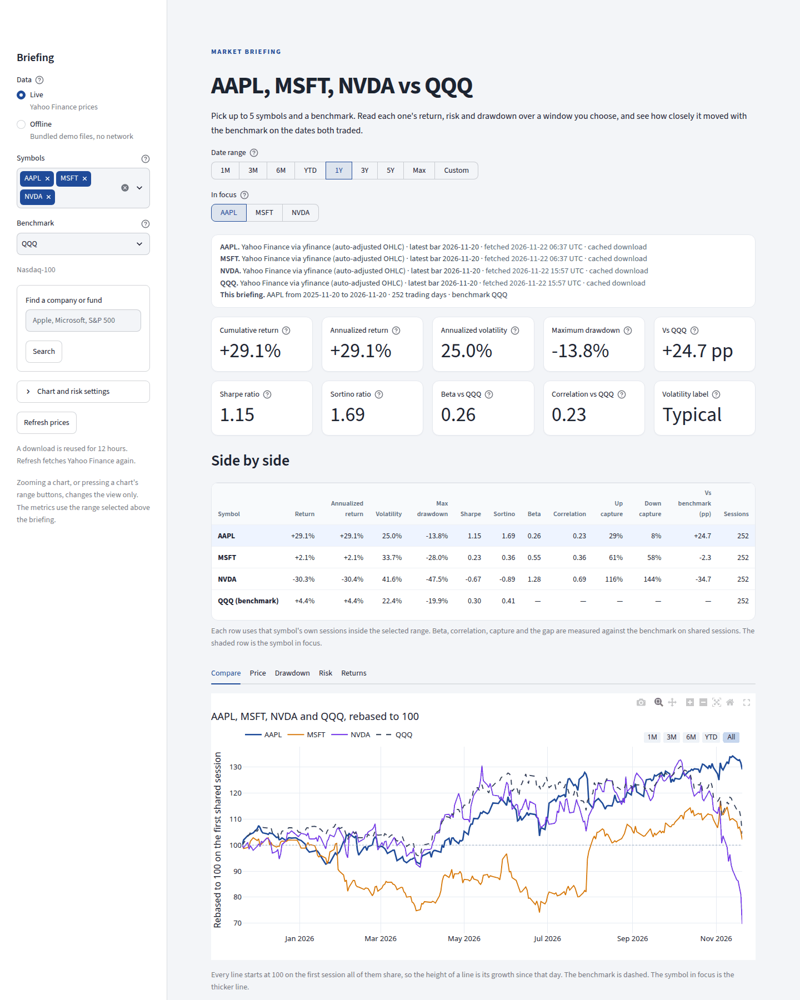

The numbers in the screenshots and the worked examples below were produced on 22 Nov 2026, when the latest Yahoo bar was 20 Nov 2026. A later run prints new prices. The definitions do not change.

## What it does

| Feature | Where it came from |
|---|---|
| Compare up to five symbols on one chart, rebased to 100, with a benchmark you choose (SPY, QQQ, DIA, IWM, or any ticker you type) | TradingView's compare overlay on a shared percent scale, Yahoo Finance's chart comparison, Koyfin's comparison graph |
| A side-by-side table: return, annualized return, volatility, drawdown, Sharpe, Sortino, beta, correlation, up and down capture | Portfolio Visualizer's risk and return metrics table |
| Rolling 63-day beta and correlation | Portfolio Visualizer's rolling metrics. One number for the whole window hides how much the relationship moves |
| Monthly returns heatmap and a daily return histogram | Portfolio Visualizer's monthly returns table; the histogram shows the tails that a volatility figure averages away |
| Candlestick and volume view with moving averages you can resize, range buttons and a range slider | TradingView and Yahoo Finance charts |
| A link that reproduces the view | TradingView and Koyfin saved views; finviz puts the whole screen in the URL |
| Portfolio mode: weights (default equal), none / monthly / quarterly rebalance, portfolio line and table row versus the benchmark | Portfolio Visualizer's portfolio backtest; weights that do not sum to 100% are scaled and named in a note |
| Company snapshot for the focused symbol (name, sector, market cap, P/E, dividend yield, 52-week range) | Yahoo Finance quote summary; offline placeholders are labelled as such |
| Company-name search (e.g. `apple` → AAPL) | Yahoo Finance symbol search |
| CSV of aligned prices and daily returns, plus a Markdown summary that includes the portfolio | Export of the same figures the page shows |
| 95% historical VaR and calendar-year returns, with sentences driven by the numbers | Historical VaR as the loss size of the 5th percentile daily return |

Left out on purpose: screeners, news, technical indicators beyond moving averages, and multi-leg options. This page still answers how selected symbols — and an optional mix of them — behaved against a benchmark over a window.

## Setup

Python 3.12. From the repository root:

```bash
python3 -m venv .venv
source .venv/bin/activate
pip install -r requirements.txt
```

Pinned packages: `numpy==2.5.5`, `pandas==3.1.1`, `streamlit==1.67.0`, `yfinance==0.2.66`, `plotly==6.3.1`. This round added no packages.

## Worked example

### Live, in the browser

```bash
streamlit run app.py
```

The page opens on AAPL against SPY for the last year. In the sidebar, add MSFT and NVDA under **Symbols** (pick from the list or type any ticker and press Enter) and set **Benchmark** to QQQ. On 22 Nov 2026, for 20 Nov 2025 through 20 Nov 2026:

| Symbol | Return | Annualized return | Volatility | Max drawdown | Sharpe | Sortino | Beta | Correlation | Up capture | Down capture | Vs benchmark (pp) | Sessions |
|---|---:|---:|---:|---:|---:|---:|---:|---:|---:|---:|---:|---:|
| AAPL | +29.1% | +29.1% | 25.0% | -13.8% | 1.15 | 1.69 | 0.26 | 0.23 | 29% | 8% | +24.7 | 252 |
| MSFT | +2.1% | +2.1% | 33.7% | -28.0% | 0.23 | 0.36 | 0.55 | 0.36 | 61% | 58% | -2.3 | 252 |
| NVDA | -30.3% | -30.4% | 41.6% | -47.5% | -0.67 | -0.89 | 1.28 | 0.69 | 116% | 144% | -34.7 | 252 |
| QQQ (benchmark) | +4.4% | +4.4% | 22.4% | -19.9% | 0.30 | 0.41 | — | — | — | — | — | 252 |

**In focus** chooses which symbol the ten cards, the single-symbol charts, the company snapshot and the sentences describe. The table and the comparison chart always show all of them.

Turn on **Portfolio mode** in the sidebar when two or more symbols are selected. Weights default to equal; monthly or quarterly rebalance is optional. The portfolio appears as its own green line on Compare and as a green-shaded row in the table.

On 22 Nov 2026, a live equal-weight AAPL+MSFT portfolio against SPY for the last year returned about **+15.6%** while SPY returned **+6.9%**. Offline Max with monthly rebalance (bundled files) returned **+28.1%** versus SPY **+21.4%**, with 95% historical VaR about **2.0%**.

The page is laid out top to bottom:

1. **Date range**: 1M, 3M, 6M, YTD, 1Y, 3Y, 5Y, Max, or **Custom** with a start and an end date.
2. **On this page**: jump to Overview, Comparison, Portfolio, Charts, or Narrative (or keep **All sections**).
3. **Status**: the source, the latest bar and the fetch time for every symbol.
4. **Company snapshot**: name, sector, market cap, P/E, dividend yield and 52-week range for the focused symbol. Missing fields are named; offline placeholders say so.
5. **Cards**: return, risk, VaR family, alpha, and drawdown recovery timing. Question-mark help text matches `docs/METHODOLOGY.md`.
6. **Side by side**: the table above. The portfolio row is green when Portfolio mode is on.
7. **Portfolio construction**: turnover/cost metrics, diversification ratio, allocation and risk-contribution charts when a mix is active. Portfolio mode with only one symbol shows a clear callout instead of a silent skip.
8. **Charts**, in five tabs:
   - **Compare**: every symbol rebased to 100 on the first session they all share. The benchmark is dashed; the portfolio is solid green.
   - **Price**: adjusted close with two moving averages, as a line or as candles with volume.
   - **Drawdown**: the stock's and the benchmark's decline from their running peaks.
   - **Risk**: rolling volatility, beta/correlation, rolling Sharpe/Sortino, and the correlation heatmap.
   - **Returns**: the daily return histogram over the benchmark's, and the monthly returns heatmap.
9. **Calendar-year returns** for the focused symbol, with a short sentence naming the best and worst years in the window.
10. **What the numbers say**: the sentences for the focus, the portfolio when present, and the comparison, plus the definition of every figure and label.
11. **AI analyst** (Narrative): a typed **Computed facts** table from the same reports as the cards, then a clearly labeled **rule-based** interpretation that may only quote those facts. Optional LLM interpretation is off by default (sidebar toggle; no keys in the repo). Every brief includes a not-financial-advice note.
12. **Download analysis summary** (Markdown), **Download price/return CSV**, and **Link to this view**.

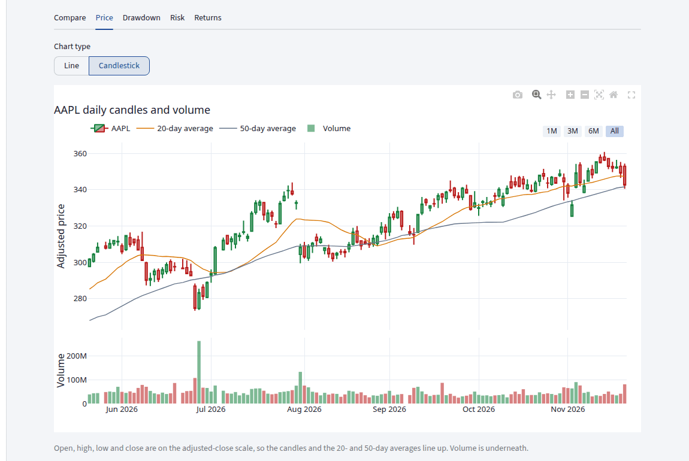

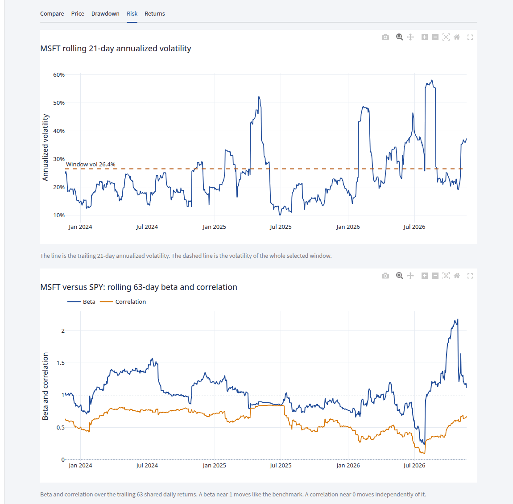

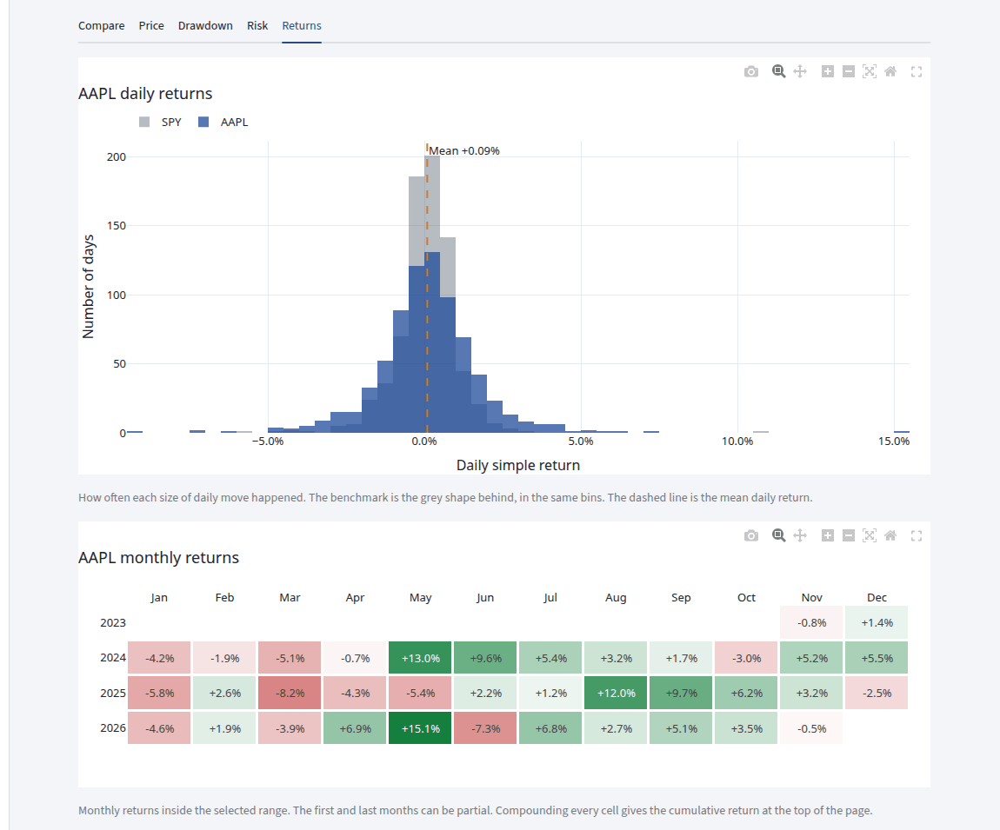

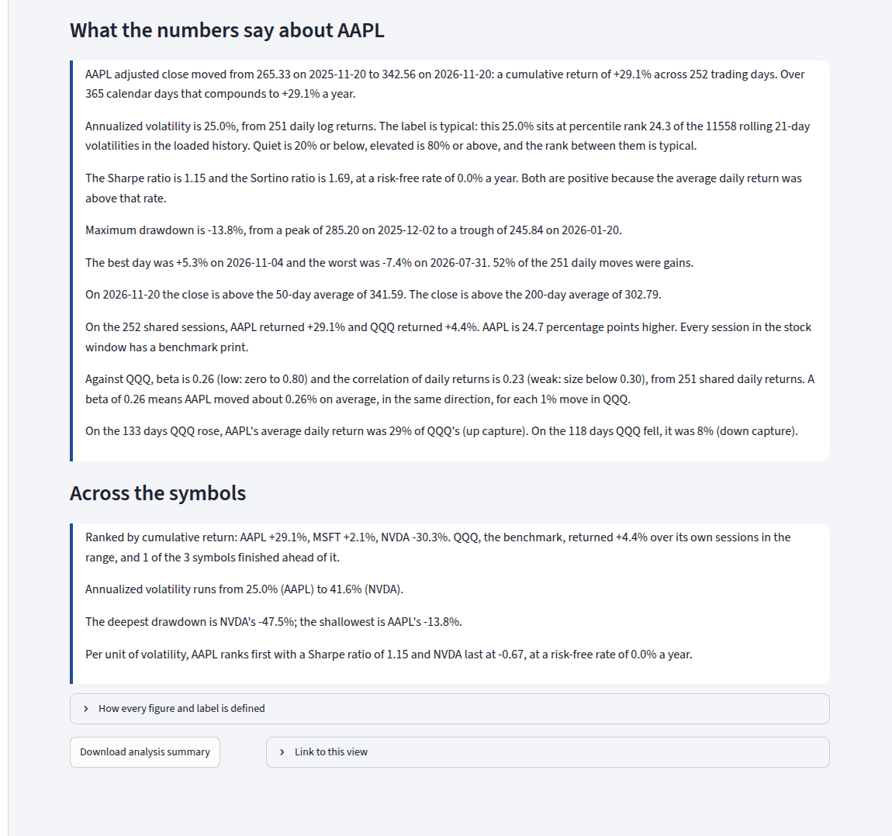

**Chart and risk settings** in the sidebar holds the two moving-average windows (2 to 400 days, the short one shorter than the long one) and the annual risk-free rate used by Sharpe and Sortino (0% to 20%, default 0%). Below that, **Portfolio mode** turns on weights and rebalance. In live mode, **Find a company or fund** searches Yahoo by name (typing `apple` suggests AAPL).

### A custom range

Choose **Custom** and set both dates. JPM and XOM against DIA, 2 Jan 2024 to 30 Jun 2025:

| Symbol | Return | Annualized return | Volatility | Max drawdown | Sharpe | Sortino | Beta | Correlation | Up capture | Down capture | Vs benchmark (pp) | Sessions |
|---|---:|---:|---:|---:|---:|---:|---:|---:|---:|---:|---:|---:|
| JPM | +74.5% | +45.2% | 25.5% | -24.4% | 1.60 | 2.37 | 1.20 | 0.72 | 122% | 89% | +54.7 | 374 |
| XOM | +10.9% | +7.2% | 22.4% | -18.9% | 0.43 | 0.58 | 0.63 | 0.43 | 58% | 56% | -8.9 | 374 |
| DIA (benchmark) | +19.8% | +12.9% | 15.3% | -16.0% | 0.87 | 1.29 | — | — | — | — | — | 374 |

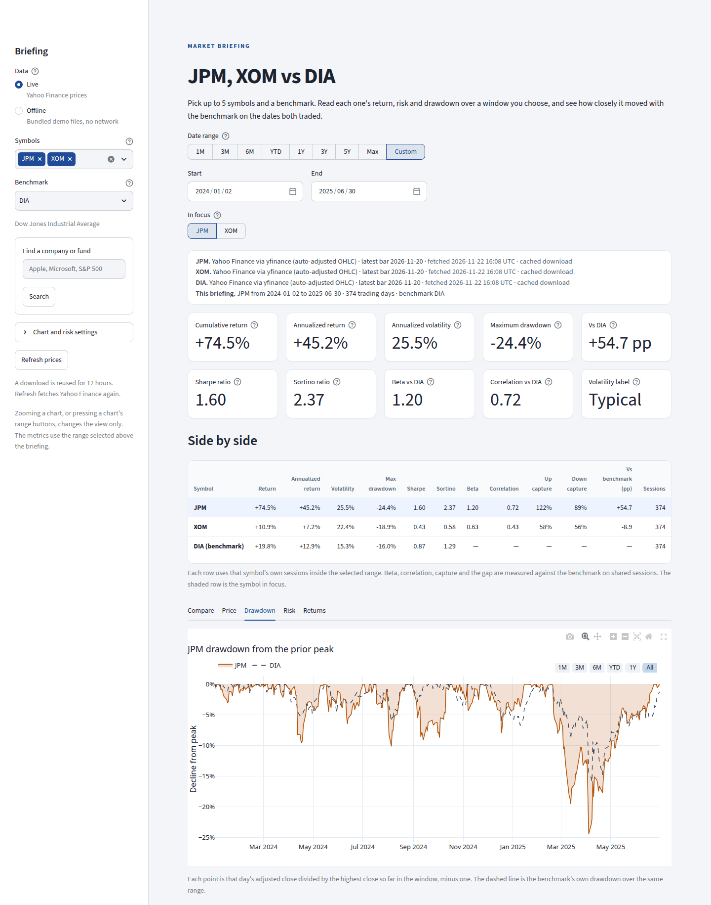

### Links

Every control writes itself into the address bar, so the address is the view. A setting left at its default is omitted.

| Parameter | Meaning | Default |
|---|---|---|
| `symbols` | One per symbol, repeated: `symbols=AAPL&symbols=MSFT` | `AAPL` |
| `benchmark` | Benchmark ticker | `SPY` |
| `range` | `1M` `3M` `6M` `YTD` `1Y` `3Y` `5Y` `Max` `Custom` | `1Y` |
| `start`, `end` | `YYYY-MM-DD`, read when `range=Custom` | the last year |
| `focus` | The symbol the cards and sentences describe | the first symbol |
| `ma_short`, `ma_long` | Moving-average windows in days | `50`, `200` |
| `rf` | Annual risk-free rate, in percent | `0` |
| `tab` | `Compare` `Price` `Drawdown` `Risk` `Returns` | `Compare` |
| `chart` | `Line` or `Candlestick` on the Price tab | `Line` |
| `data` | `Live` or `Offline` | `Live` |
| `portfolio` | `True` to turn Portfolio mode on | off |
| `rebalance` | `none` `monthly` `quarterly` | `none` |
| `w_AAPL`, `w_MSFT`, … | Weight percent for each selected symbol | equal weight when portfolio is on |

The custom-range example above is `?symbols=JPM&symbols=XOM&benchmark=DIA&range=Custom&start=2024-01-02&end=2025-06-30`. A value the page cannot use, such as a symbol the offline demo does not have, is dropped and the default is used.

### When something is wrong

One unknown symbol among several is left out with a warning, and the rest of the briefing still renders:

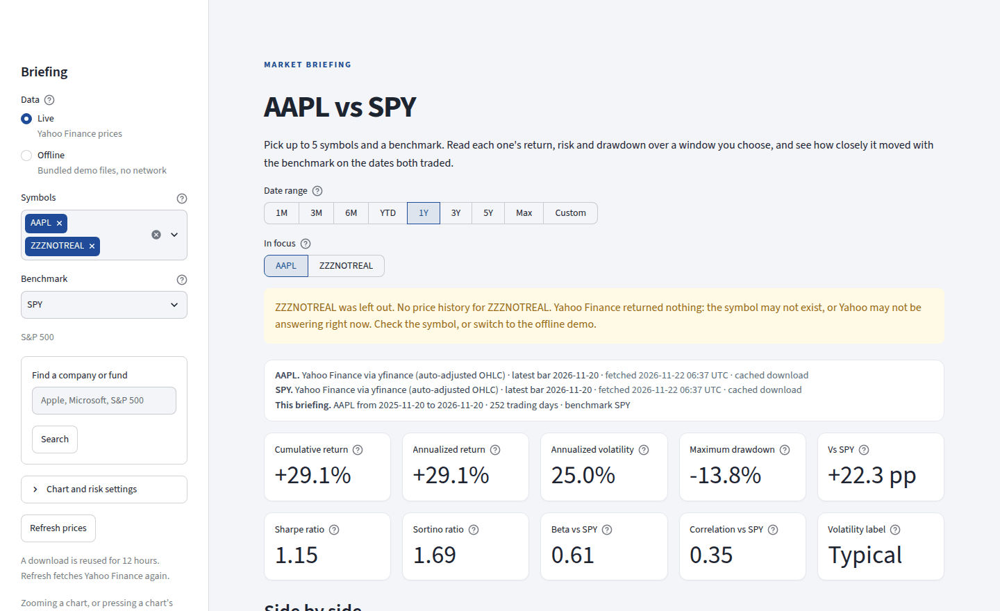

When no symbol loads, the page stops with the reason and points to the offline demo. It does not draw an empty chart:

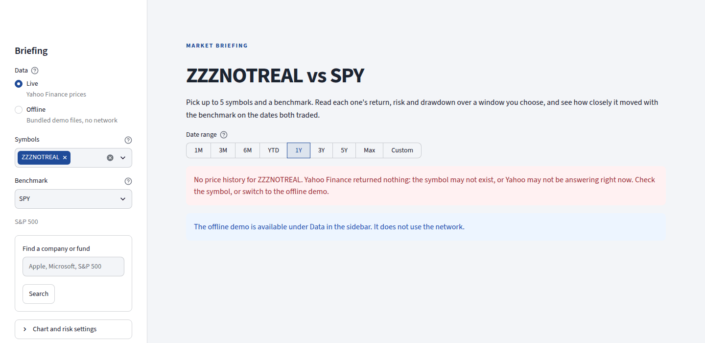

Other cases, each with its own message:

- **A range with one trading day**: "AAPL has 1 trading day(s) between … A return needs two adjusted closes. Widen the range."
- **A range too short for a figure**: that card shows a dash and its question mark says what it needs. Annualized return needs 360 calendar days, Sharpe, Sortino, beta and correlation need 20 daily returns, and each capture ratio needs 10 days on its side.
- **Yahoo not answering**: the download is tried up to three times with a short backoff (empty answers are never cached). If it still fails, a download older than 12 hours is used when one is on disk, and the page says so. With nothing on disk, the page shows the error and the offline demo is one click away.
- **Benchmark unavailable**: the stock figures still show, and the benchmark cards show a dash.
- **Moving averages in the wrong order**: "The short average (300 days) must be shorter than the long average (100 days)."
- **The benchmark is also in the symbol list**: it is removed from the list with a note.
- **Offline drops a live-only symbol**: switching to Offline, or opening an offline link that names NVDA or another symbol outside the bundle, keeps what the demo can serve and shows a notice naming what was left out (bundled data covers AAPL, MSFT, SPY, QQQ). The same happens for a benchmark that is not SPY or QQQ.
- **In focus**: only symbols that actually loaded appear in the selector. A ticker that was left out is not offered.

### Command line

```bash
python dashboard.py --tickers AAPL MSFT NVDA --benchmark QQQ --preset 1Y
```

```text
AAPL adjusted close moved from 265.33 on 2025-11-20 to 342.56 on 2026-11-20: a cumulative return of +29.1% across 252 trading days. Over 365 calendar days that compounds to +29.1% a year.
Annualized volatility is 25.0%, from 251 daily log returns. The label is typical: this 25.0% sits at percentile rank 24.3 of the 11558 rolling 21-day volatilities in the loaded history. Quiet is 20% or below, elevated is 80% or above, and the rank between them is typical.
The Sharpe ratio is 1.15 and the Sortino ratio is 1.69, at a risk-free rate of 0.0% a year. Both are positive because the average daily return was above that rate.
Maximum drawdown is -13.8%, from a peak of 285.20 on 2025-12-02 to a trough of 245.84 on 2026-01-20.
The best day was +5.3% on 2026-11-04 and the worst was -7.4% on 2026-07-31. 52% of the 251 daily moves were gains.
On 2026-11-20 the close is above the 50-day average of 341.59. The close is above the 200-day average of 302.79.
On the 252 shared sessions, AAPL returned +29.1% and QQQ returned +4.4%. AAPL is 24.7 percentage points higher. Every session in the stock window has a benchmark print.
Against QQQ, beta is 0.26 (low: zero to 0.80) and the correlation of daily returns is 0.23 (weak: size below 0.30), from 251 shared daily returns. A beta of 0.26 means AAPL moved about 0.26% on average, in the same direction, for each 1% move in QQQ.
On the 133 days QQQ rose, AAPL's average daily return was 29% of QQQ's (up capture). On the 118 days QQQ fell, it was 8% (down capture).
Ranked by cumulative return: AAPL +29.1%, MSFT +2.1%, NVDA -30.3%. QQQ, the benchmark, returned +4.4% over its own sessions in the range, and 1 of the 3 symbols finished ahead of it.
Annualized volatility runs from 25.0% (AAPL) to 41.6% (NVDA).
The deepest drawdown is NVDA's -47.5%; the shallowest is AAPL's -13.8%.
Per unit of volatility, AAPL ranks first with a Sharpe ratio of 1.15 and NVDA last at -0.67, at a risk-free rate of 0.0% a year.
Saved summary to analysis.md
```

Flags: `--ticker` or `--tickers` (up to five), `--benchmark`, `--focus`, `--preset` (`1M` `3M` `6M` `YTD` `1Y` `3Y` `5Y` `Max`) or both `--start` and `--end` as `YYYY-MM-DD`, `--ma-short`, `--ma-long`, `--risk-free` (percent a year), `--portfolio`, `--weight SYMBOL=PERCENT` (repeatable), `--rebalance` (`none` `monthly` `quarterly`), `--csv` (aligned price/return file), `--offline`, `--refresh`, `--output`.

### Offline demo

In the sidebar choose **Offline**. Nothing is downloaded, and the label above the title reads "Market briefing · offline demo". Four files are bundled:

| Symbol | File | Source | Sessions |
|---|---|---|---|
| AAPL | `aapl_raw.csv` | plotly/datasets, using the `AAPL.Adjusted` column | 17 Feb 2015 – 16 Feb 2017 |
| MSFT | `msft_sample.csv` | Yahoo Finance auto-adjusted bars saved on 22 Nov 2026 | 2 Feb 2015 – 17 Feb 2017 |
| SPY | `spy_sample.csv` | Yahoo Finance auto-adjusted bars saved on 22 Nov 2026 | 2 Feb 2015 – 17 Feb 2017 |
| QQQ | `qqq_sample.csv` | Yahoo Finance auto-adjusted bars saved on 22 Nov 2026 | 2 Feb 2015 – 17 Feb 2017 |

AAPL and MSFT can be compared against SPY or QQQ. Any other symbol asks you to switch to live data.

```bash
python dashboard.py --offline --tickers AAPL MSFT --benchmark QQQ --preset Max
```

| Symbol | Return | Annualized return | Volatility | Max drawdown | Sharpe | Sortino | Beta | Correlation | Up capture | Down capture | Vs benchmark (pp) | Sessions |
|---|---:|---:|---:|---:|---:|---:|---:|---:|---:|---:|---:|---:|
| AAPL | +10.1% | +4.9% | 24.3% | -30.4% | 0.32 | 0.45 | 1.06 | 0.72 | 104% | 109% | -13.2 | 506 |
| MSFT | +66.2% | +28.2% | 23.8% | -16.6% | 1.16 | 1.86 | 1.12 | 0.77 | 114% | 100% | +36.2 | 517 |
| QQQ (benchmark) | +30.0% | +13.7% | 16.5% | -16.1% | 0.86 | 1.21 | — | — | — | — | — | 517 |

Equal-weight AAPL+MSFT against SPY, Max, monthly rebalance (offline):

| Symbol | Return | Annualized return | Volatility | Max drawdown | Sharpe | Vs benchmark (pp) | Sessions |
|---|---:|---:|---:|---:|---:|---:|---:|
| AAPL | +10.1% | +4.9% | 24.3% | -30.4% | 0.32 | -6.3 | 506 |
| MSFT | +66.2% | +28.2% | 23.8% | -16.6% | 1.16 | +44.8 | 517 |
| Portfolio | +28.1% | +13.2% | 20.3% | -19.4% | 0.71 | +11.6 | 506 |
| SPY (benchmark) | +21.4% | +10.0% | 13.8% | -13.0% | 0.76 | — | 517 |

AAPL's 95% historical VaR on that window is about 2.5%; the portfolio's is about 2.0%. Calendar-year returns for AAPL in the sample: 2015 −16.6%, 2016 +12.4%, 2017 +17.0%. The company snapshot shows Apple Inc., Technology, with fields labelled as an offline placeholder.

AAPL's file starts ten sessions after the others and ends one session earlier. Its row covers its own 506 sessions, its gap of −13.2 points is measured on the sessions it shares with QQQ (QQQ returned +23.4% on those), and the page says so in a sentence.


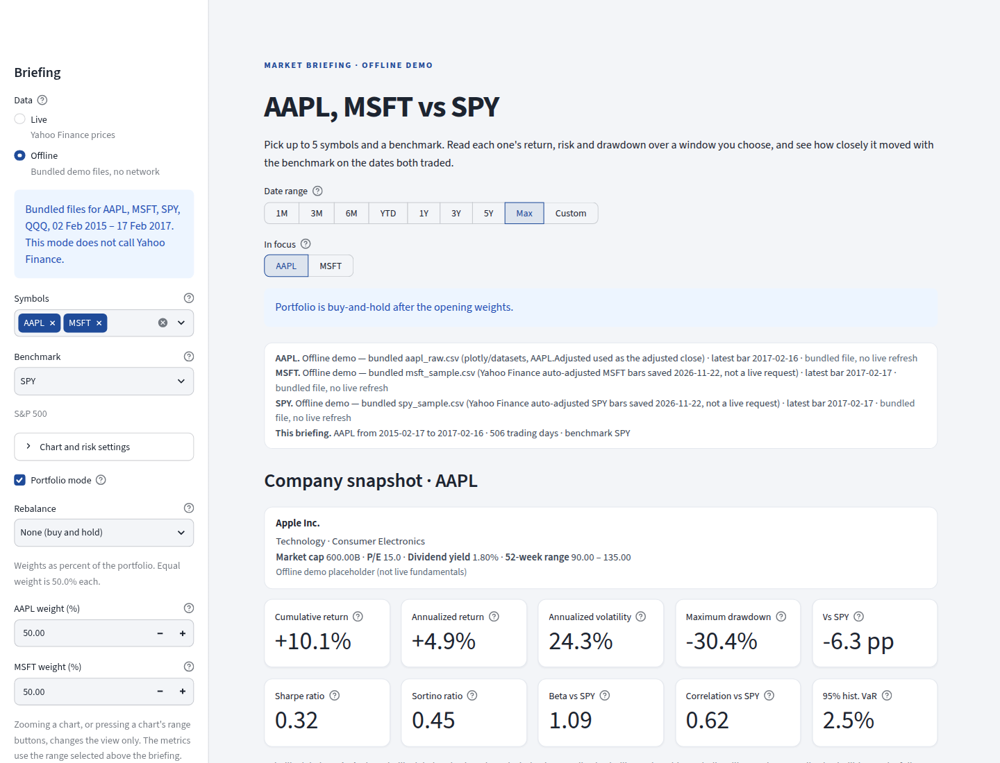

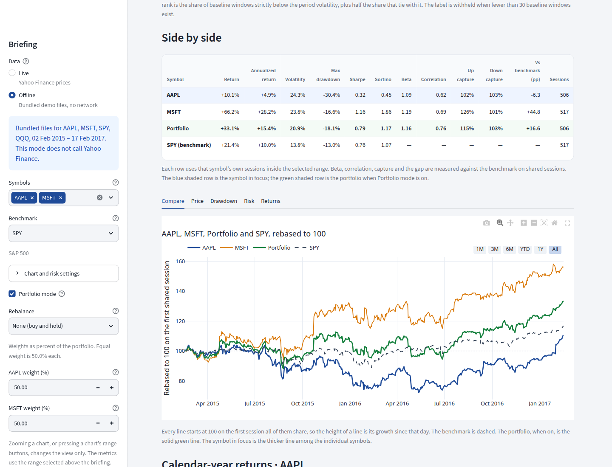

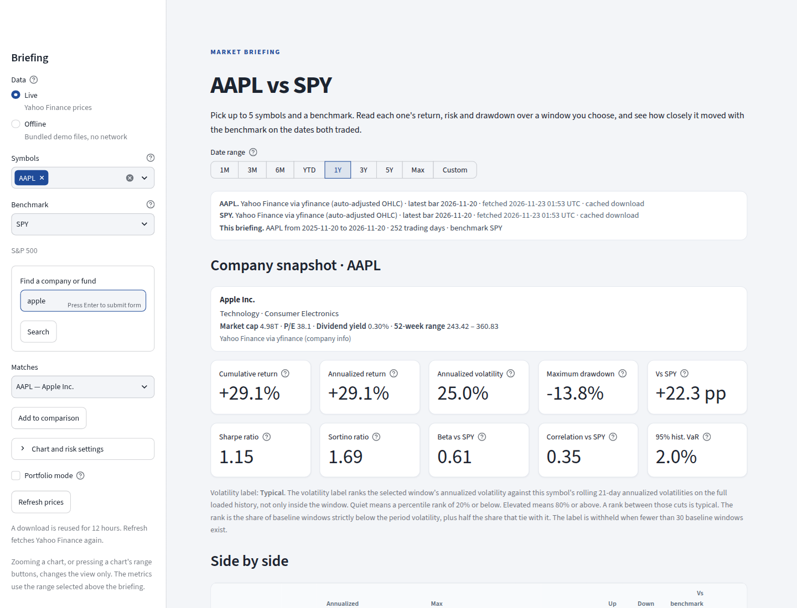

## How the figures are defined

All figures use the adjusted close. The same text is on the page under **How every figure and label is defined**, written from the constants the code uses.

**Return and risk**

- **Cumulative return** is the adjusted close on the last session of the window divided by the adjusted close on the first session, minus one.
- **Annualized return (CAGR)** is one plus the cumulative return, raised to 365.25 divided by the calendar days between the first and last session, minus one. It is withheld when the window spans fewer than 360 calendar days, because compounding a few months into a yearly rate reports a return nobody earned.
- **Annualized volatility** is the sample standard deviation (divisor N−1) of daily log returns inside the window, multiplied by the square root of 252. At least two daily returns are required.
- **Maximum drawdown** is the deepest decline from a prior peak to a later close inside the window. **Days to trough** and **days to recovery** count trading sessions peak→trough and trough→first close back at the peak (omitted if unrecovered). **Longest underwater** is the longest run below the running peak.
- **Best day, worst day** are the largest and smallest daily simple returns in the window. The share of gains is the fraction of daily returns above zero.
- **Moving averages** are simple averages of adjusted close, 50 and 200 days unless changed. They are computed on the full loaded history and then drawn on the selected dates, so a 200-day average can appear inside a shorter window.
- **Monthly returns** chain inside the window: each month's last adjusted close over the previous month's last, with the window's first close as the base of the first month. The first and last months can be partial. Compounded, the cells equal the cumulative return.
- **95% historical Value at Risk** is minus the 5th percentile of daily simple returns inside the window, reported as a positive loss fraction. At least 20 daily returns. A VaR of 2% means that on 95% of days the return was better than −2%.
- **95% parametric (Gaussian) VaR** is −(μ + z₀.₀₅ σ) with sample mean/std of daily simple returns, floored at zero.
- **95% Conditional VaR (expected shortfall)** is minus the mean of daily returns at or below the historical VaR quantile.
- **Calendar-year returns** take the first and last adjusted close inside each calendar year of the window. Partial years are allowed. A year with only one print is skipped.

**Portfolio**

- **Weights** are fractions of the portfolio. Missing weights default to equal weight. Zero-weight symbols are dropped. Negative weights are rejected. Weights that do not sum to 100% are scaled to 100% and named in a note.
- **Buy and hold** (`none`) keeps the opening share counts after day one. **Monthly** or **quarterly** rebalance marks to market with prior weights, then resets to the target at that day's close so the new mix first earns the next session (no look-ahead).
- **Transaction cost (bps)** is charged on turnover at inception and each rebalance. Turnover is half the L1 weight distance; value scales by (1 − turnover × bps / 10_000).
- **Diversification ratio** is weighted standalone volatility over portfolio volatility; **effective N** is 1/Σw²; **risk contribution** is each weight's share of portfolio variance. The **correlation heatmap** is pairwise Pearson correlations of daily returns.
- The portfolio is treated like a symbol for return, risk, drawdown, VaR, beta, alpha and the comparison chart. It needs at least two loaded symbols.

**Return per unit of risk**

- **Sharpe ratio** is the mean daily simple return above the daily risk-free rate, divided by the sample standard deviation of those excess returns, multiplied by the square root of 252. The daily risk-free rate is (1 + annual rate)^(1/252) − 1.
- **Sortino ratio** has the same numerator. Its denominator is the downside deviation: the square root of the mean squared shortfall below the risk-free rate, where days at or above the rate count as zero and every day is in the divisor.
- Both need at least 20 daily returns. A window with no day below the rate has no Sortino ratio.
- **Rolling Sharpe and Sortino** use the trailing 63 daily returns of the focus symbol, annualised the same way.

**Against the benchmark**

- **Benchmark gap.** Dates are an inner join: a session missing on either side is left out, not filled. Each cumulative return runs from the first shared session to the last. The gap is the stock's return minus the benchmark's, in percentage points. It is not a regression alpha.
- **Beta** is the sample covariance of the stock's and the benchmark's daily simple returns on shared sessions, divided by the benchmark's sample variance. At least 20 shared daily returns.
- **Jensen's alpha (annualised)** is 252 × (average stock excess return − beta × average benchmark excess return), using the same daily risk-free rate as Sharpe.
- **Correlation** is the Pearson correlation of the same pairs.
- **Up capture** is the stock's mean daily return on the days the benchmark rose, divided by the benchmark's mean daily return on those days. **Down capture** is the same on the days it fell. Each side needs at least 10 days. This is a daily arithmetic version, not the monthly compounded figure fund fact sheets print.
- **Rolling beta and correlation** use the trailing 63 shared daily returns, computed on the full loaded history and then shown on the selected dates.

Full formulas, look-ahead rules, assumptions and data-quality notes: [docs/METHODOLOGY.md](docs/METHODOLOGY.md).

**Labels**

| Label | Rule |
|---|---|
| Volatility: quiet / typical / elevated | The window's annualized volatility is ranked against this symbol's rolling 21-day annualized volatilities on the full loaded history. Quiet is a percentile rank of 20% or below, elevated is 80% or above, typical is between. Withheld under 30 baseline windows. The page prints the rank next to the word |
| Beta: high / market-like / low / inverse | High at 1.20 or above, low from zero to 0.80, inverse below zero, market-like between 0.80 and 1.20 |
| Correlation: strong / moderate / weak | Strong when its size is 0.70 or more, weak below 0.30, moderate between. A negative value is labelled negative |

**Comparing several symbols.** Each row of the table uses that symbol's own sessions inside the range. The rebased chart starts every line at 100 on the first session all of them share. When one symbol starts later than the others, a sentence says which and from when.

Zooming a chart, or pressing its range buttons, changes the view only. The figures use the range selected above the briefing.

Live OHLC from Yahoo is fetched with `auto_adjust=True`, so every symbol is adjusted the same way. The candles are scaled by adjusted close over close so they line up with the averages.

## Tests

```bash
python -m unittest discover -s tests -v
```

Run `python -m unittest discover -s tests -v` for the current count.

- `tests/test_calculations.py`: hand-computed returns, volatility, drawdown, moving averages, date alignment, volatility labels.
- `tests/test_metrics.py`: Sharpe, Sortino, beta, correlation, capture, rolling metrics, monthly returns, settings limits, pipeline beta=2 case.
- `tests/test_pipeline.py`: offline/live briefings, cache, outages, CLI, multi-symbol edges.
- `tests/test_portfolio_and_risk.py`: weights, buy-and-hold and monthly rebalance hand paths (MTM-then-reset), historical VaR, calendar years, snapshots, CSV, search.
- `tests/test_advanced_quant.py`: drawdown recovery/underwater, parametric VaR, CVaR, Jensen alpha, diversification, cost-aware backtest, rolling Sharpe, look-ahead guards (rebalance-day prior weights; no forward fill).
- `tests/test_analyst.py`: typed AnalystFacts, rule-based claim traceability, not-financial-advice, optional LLM off-by-default and drop of untraceable claims.
- `tests/test_app.py`: Streamlit `AppTest` cards (15 metrics including parametric VaR, CVaR, alpha, recovery days), portfolio mode, CSV, search, share links, AI analyst panels.

## Layout

```
data_loader.py   prices, search, company snapshot, 12-hour cache, bundled files
features.py      returns, risk, VaR/CVaR, alpha, diversification, portfolio/costs, ratios, sentences
plots.py         Plotly charts (including correlation heatmap and rolling Sharpe/Sortino)
dashboard.py     one briefing, command line, Markdown and CSV export
analyst.py       typed facts + rule-based (default) / optional LLM interpretation
app.py           the page
docs/METHODOLOGY.md  formulas, look-ahead rules, assumptions, data quality
```

`plots.py` does not read files. `features.py` does not draw. `dashboard.py` is the only place the pieces are assembled. `analyst.py` only reads computed reports (never CSV or Plotly). `app.py` only collects inputs and displays that result.

## Known limitations

- The live path needs Yahoo Finance to answer. There is no key, and there is also no contract. A cold start that returns nothing is retried automatically a few times before the page gives up; empty answers are not cached. If it still fails, the page falls back to an older download when one is on disk and otherwise shows the error. On Streamlit Community Cloud the disk is wiped when the app restarts, so that fallback only covers symbols loaded since the last restart.
- yfinance 0.2.66 prints pandas deprecation warnings under pandas 3.1. The downloads used here still return adjusted history.
- The risk-free rate is one number you set, 0% by default. It is not a Treasury bill series. Sharpe and Sortino at 0% are higher than a fact sheet's when rates are above zero.
- Sharpe, Sortino, beta and capture are computed from daily returns. Portfolio Visualizer and fund fact sheets use monthly returns, so their figures for the same period will differ.
- The volatility label is a rank inside one symbol's own history. A 25% year can be "typical" when older decades were wilder. Read the percentile next to the word.
- The table gives each symbol its own sessions. A symbol that listed part-way through the range has a shorter row, and its return is not comparable with the others until the range is narrowed to dates they share. The page names the symbol and the date.
- Rolling beta and correlation need 63 shared daily returns of history before the first point.
- Five symbols at most. Portfolio mode mixes those that loaded; proportional bps costs are modelled, but taxes, cash drag and bid–ask schedules are not.
- Company facts come from yfinance `info`. Fields Yahoo leaves blank stay blank. Offline snapshots are illustrative placeholders labelled as such, not restated fundamentals for 2015–2017.
- Historical, parametric and Conditional VaR use daily simple returns inside the window. They are not multi-day horizon limits and Gaussian VaR understates fat tails.
- Offline AAPL is the 2017-vintage plotly file. The other three offline files were saved from Yahoo on 22 Nov 2026, so AAPL was not adjusted on the same day as its benchmark. The offline sample ends in Feb 2017.
- With `range=Custom` left on the dates the page proposes, the address bar omits `start` and `end`, so that address would move with the calendar. **Link to this view** always writes the two dates out, so use that box for a custom range.
- The cache is a local `.cache/` directory, ignored by git, reused for 12 hours.
- Symbol search returns equities and ETFs. A blank or a symbol with spaces or punctuation is rejected before any download.
- Portfolio rebalance query params bind after Portfolio mode is on; a shared link that only sets `rebalance` without `portfolio=True` leaves rebalance at none until the checkbox is enabled.
- Narrow screens tighten padding and metric type; the comparison table scrolls horizontally below 900px. Streamlit's own sidebar drawer still owns the phone layout.
- This round does not change Streamlit Community Cloud hosting settings; redeploy the branch you choose after merge.

## Publish on Streamlit Community Cloud

No secret is required. The deployed app does need outbound HTTPS to Yahoo Finance for live symbols. The offline demo does not.

1. Open [share.streamlit.io](https://share.streamlit.io) and sign in with the GitHub account that owns `mastermind7610/market_dashboard`.
2. Choose **Create app**, then **Yup, I have an app**.
3. Repository `mastermind7610/market_dashboard`, branch `main` after this pull request is merged (or branch `cursor/portfolio-and-fundamentals-5ee9` to preview), main file path `app.py`.
4. Under **Advanced settings**, select **Python 3.12**. Leave secrets empty.
5. Deploy. Community Cloud installs `requirements.txt` and runs `streamlit run app.py`.

The public URL is the subdomain chosen in that form, of the shape `https://<name>.streamlit.app`. A push to the deployed branch redeploys the app.
